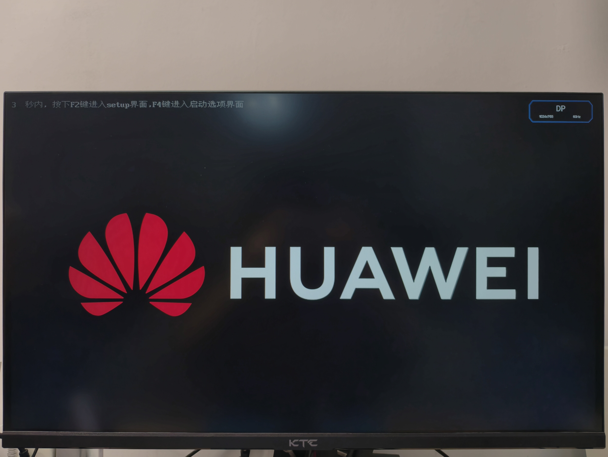
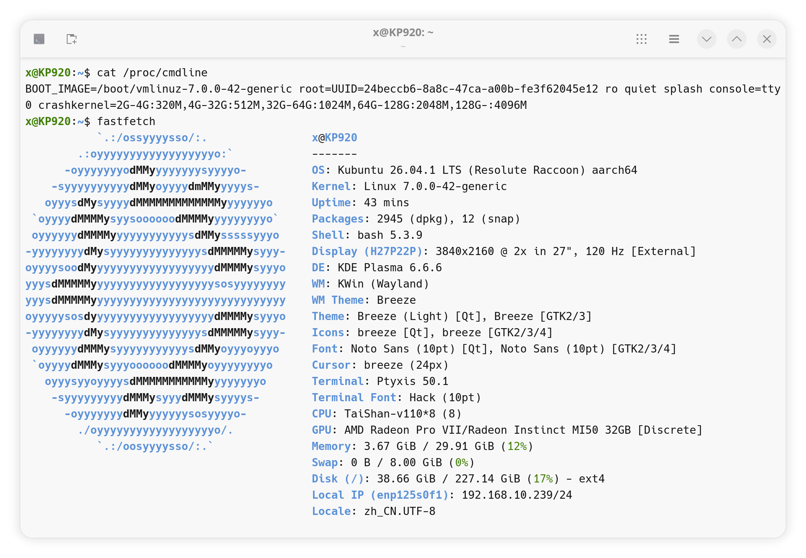

# BC32MBHB / D920L11K-2251K BIOS 修改

Kunpeng Desktop Board **D920L11K-2251K**（板号 **BC32MBHB**）的 BIOS 修改：
让 AMD **Radeon 520**（Polaris）、**Vega 20**（Radeon Pro VII / Instinct MI50，
`1002:66A1`）和 **RX 6600**（Navi 23，`1002:73FF`）在 BIOS POST/Setup
显示；并修复 DDRC PMU 与 MPAM 两个固件问题，使 Linux 不再需要
`arm64.nompam` / `initcall_blacklist=hisi_ddrc_pmu_module_init`。

## 实机展示

Huawei 开机 LOGO（Vega 20，DP 1024x768）：

<p align="center">
  
</p>

系统正常启动（`/proc/cmdline` 已去掉 `arm64.nompam` 和
`initcall_blacklist`；Radeon Pro VII / MI50 32GB 已由 amdgpu 识别）：

<p align="center">
  
</p>

## 1. 当前定制版本：1.0-5

当前只有一个定制版本：

```
firmware/modified/BC32MBHB-D920L11K-2251K_1.0-5_2020-07-22.bin
```

| 字段 | 值 | 含义 |
|---|---|---|
| 产品 / 板号 | `BC32MBHB-D920L11K-2251K` | Kunpeng Desktop Board D920L11K-2251K（板号 BC32MBHB） |
| BIOS Version | `1.0-5` | 原厂 `1.0`，固件内 BIOS Version 字段改为 `1.0-5` |
| 定制版本 | `5` | 本地第 5 个定制构建；只作文件名/构建标签 |
| 构建日期 | `2020-07-22` | 原厂 BIOS 构建日期 |

说明：

- **EC 版本 `0.23`** 是主板上嵌入式控制器（EC）的固件版本，Setup 通过 EC
  读取，和主 BIOS 是两套固件；本镜像**不修改** EC 版本。
- **内核版本 `v2.70`** 是另一个内部组件版本（EC 内核/BIOS Core），也不是
  本定制版本号。
- 本镜像把固件内的 **BIOS Version 字段从 `1.0` 改为 `1.0-5`**；
  EC 版本 `0.23` 不变；`dmidecode -s bios-version` 预期显示 `1.0-5`。
- 定制版本号 `1.0-5` 同时用于文件名、构建记录和 BIOS Version 显示。
- **DDRC PMU 修复**：DSDT 中 4 个 `HISI0233`（`\_SB.DDR0..DDR3`）改为
  `HISI9999`；`hisi_uncore_ddrc_pmu` 不再匹配/自动加载，避免读取
  `DDRC_VERSION` 时挂死。DDRC PMU 事件不再可用（与之前 blacklist 一致）。
- **MPAM 修复**：FIP 内 BL31 的 2 个入口序列改为调用 stub，设置
  `MPAM3_EL3 = 0x8000000000000000`（MPAMEN=1，TRAPLOWER=0），
  Linux 不再需要 `arm64.nompam`。

`1.0-5` 的改动：

- **保留原厂 1.68 pre-SoC15 `Arm64Gop` FFS 字节不变**，负责 Radeon 520 / Polaris；
- 在 inner DXE FV 末尾**追加 post-SoC15 2.10 `Arm64Gop` FFS**
  （GUID `92F10585-FB63-430F-8188-71FEEB2DDA5B`，UI 名 `ARM64Gop 2.10`），
  负责 Vega 20；
- **追加 AMD AArch64 GOP 3.1.0**（GUID `7E3C9B1A-5D42-4F86-A0C7-2B9E8D1F4A63`，
  UI 名 `ARM64Gop 3.1.0 RX6600`），从 Sapphire RX 6600 VBIOS 的 AArch64
  EFI 镜像解压得到，PE 字节和 AMD 签名保持原样，负责 Navi 23 / RX 6600；
- **替换开机 LOGO**：原 PowerLeader `300x95` 24-bit BMP 替换为
  `images/Huawei-Logo.bmp`（`840x260` 24-bit，内容 `820x240`，
  黑底白字 + 红色花瓣）；实测固件 GOP 为 1024 宽、4:3，4K 显示器会横向
  拉伸，因此 LOGO 按约 3.42:1 预补偿；拉伸后约 4.54:1、占屏幕约 80% 宽；
- **固件内 BIOS Version 字段 `1.0` → `1.0-5`**（版本信息块绝对 `0xBF0098`）；
  VersionInfoPeim 默认版本字符串和复制长度同步修改；EC 版本保持 `0.23`；
- **DDRC PMU ACPI 修复**：DSDT 中 4 个 `HISI0233` 改为 `HISI9999` 并重算
  DSDT checksum；消除 `hisi_uncore_ddrc_pmu` 的 `DDRC_VERSION` 挂死；
- **BL31 MPAM 修复**：FIP 内 BL31 的两个入口序列写入 stub，初始化
  `MPAM3_EL3`（MPAMEN=1、TRAPLOWER=0）；只改 BL31 内 32 字节；
- **Setup 静态 HII 标题不修改**，仍显示 `Byosoft ByoCore BIOS V1.0`；
  标题和 BIOS Version 字段是两套独立字符串；
- 三个 PE（1.68 / 2.10 / 3.1.0）都保留 AMD 签名；FV/FFS/block map/LZMA
  均自检通过；
- 除 GOP、LOGO、BIOS Version、DDRC HID 和 BL31 外，其他 FV/版本结构
  保持原厂。

实机验证：

- Radeon 520、Vega 20 的 BIOS POST/Setup 显示均正常（沿用 1.0-4 验证）；
- 840x260 预补偿 LOGO 显示正常、比例/大小合适、约 80% 屏宽；
- EC 版本 `0.23` 保持原厂；1.0-4 已实机确认
  `dmidecode -s bios-version` = `1.0-4`；1.0-5 的版本字段预期为 `1.0-5`；
- DDRC 修复已实机验证：DSDT 设备为 `HISI9999:00..03`，去掉
  `initcall_blacklist=hisi_ddrc_pmu_module_init` 可正常启动，
  `hisi_uncore_ddrc` 未加载；
- BL31 MPAM 修复已实机验证：从 U 盘启动、GRUB 中同时去掉
  `arm64.nompam` 和 `initcall_blacklist` 可正常启动；
- **RX 6600：1.0-5 新增 3.1.0 GOP，待实机验证**；测试时需同时回归
  Radeon 520 / Vega 20，确认新增驱动没有重复绑定或显示回退。

SHA-256：

```
ee17e1eb761d658e7e0c9104ac7dcefade8156a90ac826329616489ad3027c77
```

版本号更新规则：只改 `scripts/rebuild_bios.py` 里的
`CUSTOM_VERSION`（当前为 `5`）。脚本会自动更新：

- 输出文件名 `1.0-N`
- 版本信息块 BIOS Version 字段（`0xBF0098`）
- VersionInfoPeim 的默认版本字符串和复制长度

标签总长度需小于 8 字符（8 字节版本块限制），例如 `1.0-5`、`1.0-10`
都可以；脚本会在超长时报错。仍然只发布一个当前版本，不并列多个镜像。

## 2. 支持功能

| 显卡 | BIOS 显示 | 说明 |
|---|---|---|
| Radeon 520 / Polaris | ✅ | 原厂 1.68 pre-SoC15 GOP（字节未改） |
| Vega 20（`1002:66A1`） | ✅ | 2.10 post-SoC15 GOP |
| RX 6600 / Navi 23（`1002:73FF`） | 🟡 实验 | 3.1.0 签名 AArch64 GOP（从 RX 6600 VBIOS 提取）；待实机验证 |
| Radeon 520 + Vega 20（同一镜像） | ✅ | 两个 GOP 并存；两卡分别验证正常 |
| RX 5700 XT / Navi 10 | ❌ | 实测在 Kunpeng 上不被 PCIe 枚举（Gen3/2/1 均 `DLActive-`），电气/链路不兼容，不是 BIOS/GOP 问题 |
| RX 6000 其他型号 | ❌/未知 | 仅 RX 6600 的 3.1.0 驱动来自对应 VBIOS；其他 ID 未验证 |

- Vega 20 下内核日志出现 `simple-framebuffer`/`simpledrm`，随后 amdgpu 接管。
- 除 GOP/LOGO/DSDT/BL31 补丁外，前 8 MiB 的 bootloader/IMU 和其他 FV
  结构保持不变。
- 3.1.0 GOP 的绑定逻辑由 VBIOS 驱动，可能也匹配其他 AMD 显卡；测试 RX 6600
  时必须同时回归 Radeon 520 / Vega 20。若出现重复绑定或显示回退，回退
  1.0-4 或按 `docs/KP920_VEGA20_BIOS_NOTES.md` 的 RX 6600 章节调整。

## 3. 安装依赖

修改脚本只需要 Python 3（标准库，无 pip 依赖）：

```bash
python3 --version          # 3.8+ 即可
```

可选工具：

```bash
# UEFIExtract（结构检查/生成 report，可选）
sudo apt install uefitool-cli

# 如果使用 Linux 下的 flashrom 在线/编程器刷写
sudo apt install flashrom
```

刷写硬件：

- SPI 编程器（CH341A、RT809H 等）；
- 本板 SPI 芯片为 **W25Q128JWSQ，1.8 V**（以实际芯片丝印为准）；
  3.3 V 编程器需要 1.8 V 转接座，避免损坏芯片；
- Windows 下可用 NeoProgrammer / AsProgrammer 等。

## 4. 生成 1.0-5

所有命令都在项目根目录执行；脚本只读原厂镜像，不会修改
`firmware/original/`。

```bash
python3 scripts/rebuild_bios.py
```

- 默认源：`firmware/original/BC32MBHB-D920L11K-2251K_1.0_2020-07-22.bin`
- 默认驱动：
  - `drivers/ARM64Gop_2_10.efi`（Vega 20）
  - `drivers/ARM64Gop_3_1_0.efi`（RX 6600 / Navi 23）
- 默认 LOGO：`images/Huawei-Logo.bmp`（840x260 24-bit，4:3→16:9 预补偿）
- 固定输出：`firmware/modified/BC32MBHB-D920L11K-2251K_1.0-5_2020-07-22.bin`
- SHA-256：`ee17e1eb761d658e7e0c9104ac7dcefade8156a90ac826329616489ad3027c77`
- `firmware/modified/` 是构建产物目录，已在 `.gitignore` 中排除，
  不纳入 git；需要时运行脚本重新生成。

说明：

- 脚本按当前代码固定构建 `1.0-5`，不再提供多个版本/模式选项。
- 每次从原厂镜像重建，不读取上一次输出；同样的源/驱动/liblzma 下重复运行
  输出哈希相同。
- 构建会检查源镜像 SHA、DSDT SHA、BL31 SHA、1.68 PE、2.10 和 3.1.0 驱动
  SHA、LOGO SHA；所有自检通过后才写文件。
- 脚本把固件内 BIOS Version 字段 `1.0` 改为 `1.0-5`；EC 版本 `0.23`
  保持不变。
- 脚本同时把 DSDT 的 4 个 `HISI0233` 改为 `HISI9999` 并重算 checksum，
  并在 BL31 两个入口写入 MPAM stub（只改 BL31 内 32 字节）。
- 3.1.0 GOP 的 PE 字节和 AMD 签名保持原样，只在外面新增 FFS 包装。
- 若输出文件已存在且内容不同，脚本默认拒绝覆盖；确认覆盖时加 `--force`。
- 可选结构检查：

```bash
uefiextract "firmware/modified/BC32MBHB-D920L11K-2251K_1.0-5_2020-07-22.bin" report
```

## 5. 刷写 BIOS

支持两种方式。**BIOS 内置固件升级已实机验证**（DDRC ACPI 修复的
1.0-4 测试镜像）；1.0-4 的启动验证已通过（U 盘启动，去掉两个参数）。
**1.0-5 新增 RX 6600 GOP，待实机验证**；刷写时仍建议用 SPI 编程器写整片，
确保 BL31 区域确实写入，并避免同版本 `VersionCheck` 拒绝。

### 5.1 BIOS 内置固件升级（Step 1 已验证）

- 把
  `firmware/modified/BC32MBHB-D920L11K-2251K_1.0-5_2020-07-22.bin`
  复制到 U 盘（建议根目录）。
- 在 BIOS Setup 的固件升级/更新功能中选择文件名：
  **`BC32MBHB-D920L11K-2251K_1.0-5_2020-07-22.bin`**
  （U 盘升级界面只显示文件名，没有 `firmware/modified/` 路径）。
- 仅含 DDRC ACPI 修复的 Step 1 测试镜像已用此方式实机验证，不需要编程器；
  **最终含 BL31 的镜像建议用 5.2 的 SPI 编程器**。
- 刷写前核对文件 SHA-256：
  `ee17e1eb761d658e7e0c9104ac7dcefade8156a90ac826329616489ad3027c77`。
- 已实机验证该方式可用（1.0-3 → 1.0-4 的 DDRC 测试镜像）；具体菜单名称
  和支持的升级介质（U 盘/网络等）以主板 Setup 为准。
- 最终镜像含 BL31：若走内置升级，刷后应读回/用编程器核对 BL31
  `0xBB328D/0xBB33A5/0xBBB08D`，确认已写入；同版本重刷可能被
  `VersionCheck` 拒绝，此时用 5.2 编程器。
- 刷写后首次启动可能较久；若 OS 启动项丢失，在 Setup/Boot Manager
  重新选择。

### 5.2 SPI 编程器（离线刷写）

1. 确认原厂备份存在：
   `firmware/original/BC32MBHB-D920L11K-2251K_1.0_2020-07-22.bin`
   （SHA-256 `e900c384175cf424b970163109cfe36829fa0d459fbd99d1af954257f63b3704`）。
   建议再用编程器做一次**当前 SPI 全片备份**（保留 NVRAM/启动项）。
2. 完全断电、拔电源线，取出 SPI 芯片。
3. 确认芯片型号/电压（W25Q128JWSQ，1.8 V）；使用匹配的编程器和转接座。
4. 写入**完整 16 MiB 镜像**（`1.0-5`，含 BL31 修改），写后读回校验 SHA-256。
5. 芯片装回，接好目标显卡和显示器，开机；首次启动等待内存/IMU 训练，
   按 F2 进 Setup。
6. 刷完整镜像会覆盖 NVRAM；若 OS 启动项丢失，在 Setup/Boot Manager
   重新选择。

回退：用 BIOS 内置升级或编程器写回原厂镜像。
详细刷写步骤/结果判断见 `docs/FLASH_GUIDE.md`。

## 6. 主要文件

| 文件 | 用途 | SHA-256 |
|---|---|---|
| `firmware/original/BC32MBHB-D920L11K-2251K_1.0_2020-07-22.bin` | 原厂备份 / 恢复 | `e900c384...` |
| `firmware/modified/BC32MBHB-D920L11K-2251K_1.0-5_2020-07-22.bin` | **当前定制版本**：Radeon 520 + Vega 20 + RX 6600 + Huawei LOGO + DDRC/MPAM 修复 | `ee17e1eb...` |
| `drivers/ARM64Gop_2_10.efi` | AMD post-SoC15 2.10 GOP（Vega 20 构建源） | `c0b47fe3...` |
| `drivers/ARM64Gop_3_1_0.efi` | AMD AArch64 GOP 3.1.0（从 RX 6600 VBIOS 提取，Navi 23） | `e84a703d...` |
| `drivers/Arm64Gop_1_68.efi` | 原厂 pre-SoC15 1.68 GOP（字节对照） | `22021e0a...` |
| `reference/Sapphire.RX6600.8192.210615.rom` | Sapphire RX 6600 VBIOS（3.1.0 GOP 提取源 / 分析参考） | `f0257009...` |
| `images/Huawei-Logo.wine.png` | 开机 LOGO 源图 | — |
| `images/Huawei-Logo.bmp` | 固件用 840x260 24-bit 开机 LOGO | `8944e3eb...` |
| `scripts/rebuild_bios.py` | 解压/追加 GOP/替换 LOGO/DSDT HID/BL31 MPAM/重压缩/重建 | — |
| `reports/BC32MBHB-D920L11K-2251K_1.0-5_2020-07-22.bin.report.txt` | UEFIExtract 结构报告 | — |

## 7. 文档

- `docs/FLASH_GUIDE.md`：刷写步骤、结果判断、回退方法。
- `docs/KP920_VEGA20_BIOS_NOTES.md`：完整分析、固件偏移、构建方式与实机验证记录；
  其中 RX 6600 章节记录 3.1.0 GOP 的提取和构建方法。

## 8. 版权与合理使用声明

以下原厂/第三方资源版权归原作者/权利人所有，此处仅用于教育/演示目的，基于合理使用原则（Fair Use）：

- `firmware/original/BC32MBHB-D920L11K-2251K_1.0_2020-07-22.bin`（BC32MBHB / D920L11K-2251K 原厂 BIOS 镜像 1.0）版权归华为技术有限公司（Huawei Technologies Co., Ltd.）所有；镜像中包含的 Byosoft、EDK2 等第三方组件版权归各自权利人所有。此处仅用于教育/演示目的，基于合理使用原则（Fair Use）。
- `reference/AMD.RadeonProVII.16384.200818.rom`（AMD Radeon Pro VII / Radeon Instinct MI50，Vega 20，VBIOS `113-D1640600-104`）版权归 Advanced Micro Devices, Inc.（AMD）所有，此处仅用于教育/演示目的，基于合理使用原则（Fair Use）。
- `reference/vbios.rom`（上述 AMD Radeon Pro VII VBIOS 的前 104,448 字节截取副本）版权归 Advanced Micro Devices, Inc.（AMD）所有，此处仅用于教育/演示目的，基于合理使用原则（Fair Use）。
- `drivers/Arm64Gop_1_68.efi`（AMD ARM64 GOP 驱动 1.68）版权归 Advanced Micro Devices, Inc.（AMD）所有，此处仅用于教育/演示目的，基于合理使用原则（Fair Use）。
- `drivers/ARM64Gop_2_10.efi`（AMD ARM64 GOP 驱动 2.10）版权归 Advanced Micro Devices, Inc.（AMD）所有，此处仅用于教育/演示目的，基于合理使用原则（Fair Use）。
- `reference/Sapphire.RX6600.8192.210615.rom`（Sapphire RX 6600 8GB VBIOS，`113-2447LHS-UDB`，Navi 23）版权归 Advanced Micro Devices, Inc.（AMD）及 Sapphire Technology 所有，此处仅用于教育/演示目的，基于合理使用原则（Fair Use）。
- `drivers/ARM64Gop_3_1_0.efi`（从上述 VBIOS 的 AArch64 EFI 镜像解压出的 AMD GOP 驱动 3.1.0）版权归 Advanced Micro Devices, Inc.（AMD）所有，此处仅用于教育/演示目的，基于合理使用原则（Fair Use）。

## 9. 许可证

除第 8 节列出的第三方资源外，本项目原创的脚本、文档和构建代码采用
**DO WHATEVER PUBLIC LICENSE（DWPL）** 授权（许可证文本由 Justin Lloyd
发布，原作者主页：`http://otakunozoku.com/`）：

- 许可证全文：[`LICENSE`](LICENSE)
- 允许复制、修改、分发和商业使用，不提供任何担保。
- 第三方资源不适用本许可证，其版权仍归各自权利人所有。
